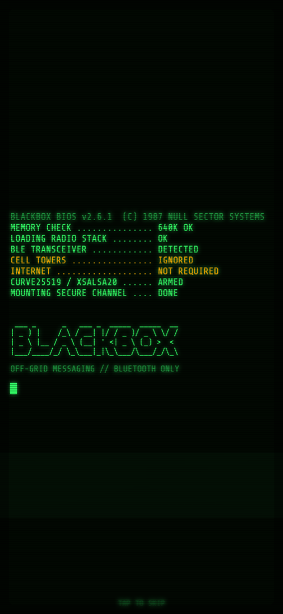
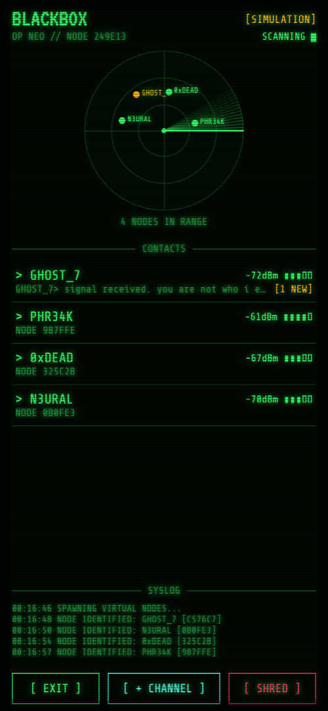
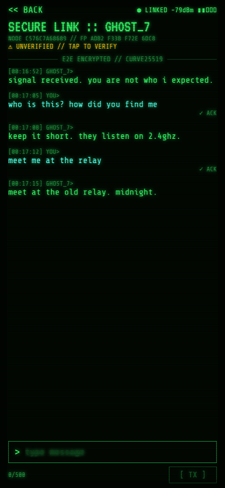
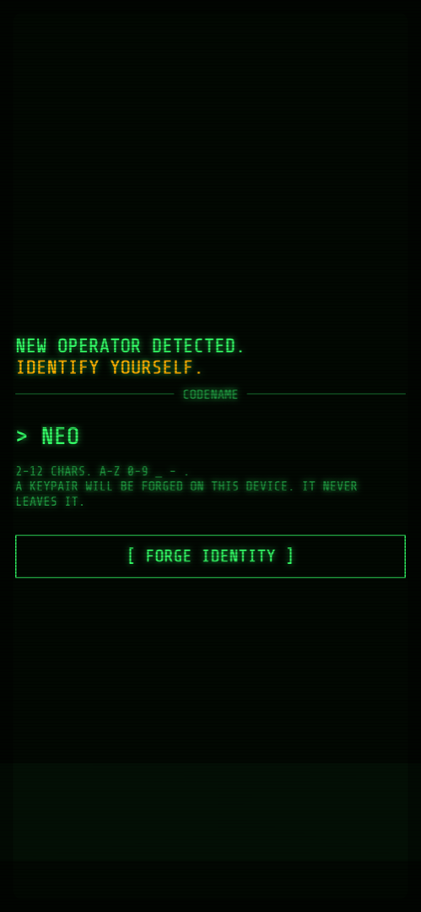
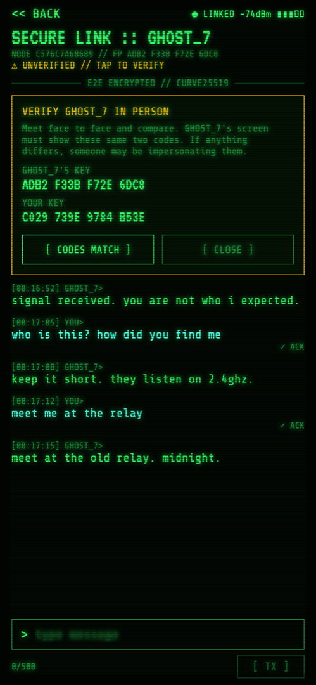
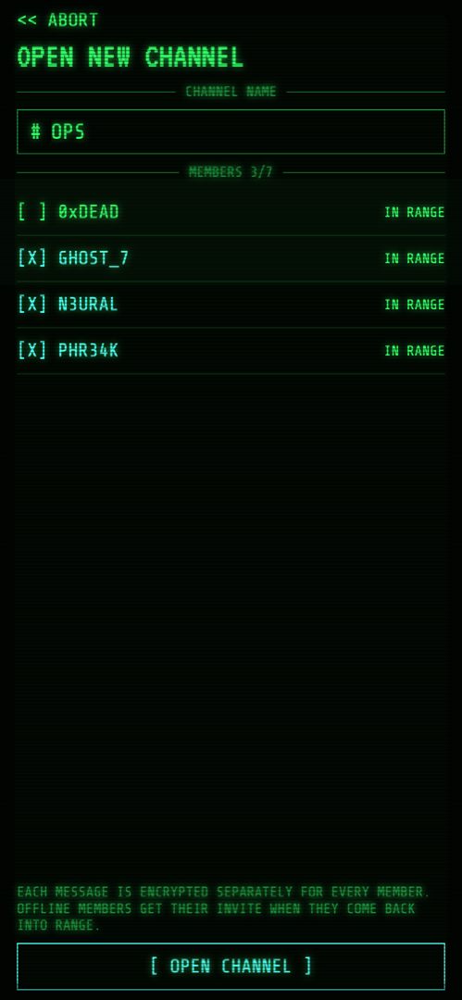
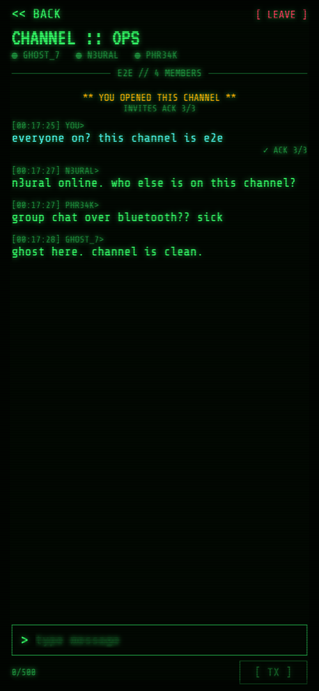

# Meshly

**An off-grid, end-to-end encrypted messenger that works over Bluetooth only.**
No internet, no SIM card, no servers, no accounts. Phones talk directly to each other over
Bluetooth Low Energy (BLE). It has a retro hacker-terminal look. The app is called **BLACKBOX**.

Built with React Native + Expo for **Android and iOS**.

<p align="center">
  
  
  
</p>

---

## Features

### Messaging
- **Bluetooth-only chat.** Find nearby phones and message them with no internet or mobile network.
- **Group channels.** Group chats of up to 8 people, with per-member delivery receipts (`ACK 2/3`).
- **Offline outbox.** Messages to someone out of range wait in a queue and send automatically when
  they come back.
- **Delivery receipts.** `✓ ACK` means the other phone's radio actually received the message.
- **Live radar.** An animated sweep shows nearby phones as blips, with signal strength in dBm.
- **Simulation mode.** Fake contacts that reply, so you can try the whole app without any hardware.

### Security
- **End-to-end encryption.** Curve25519 + XSalsa20-Poly1305 (NaCl `box`). Only the recipient can
  read a message.
- **Hidden metadata.** The message text, sender name, message ID and timestamp are all inside the
  encryption. Over the air, only the sender's public key is visible.
- **Impersonation-proof identities.** Your node ID is derived from your public key, and every
  message is authenticated. Forged or tampered packets are rejected.
- **Replay protection.** Each message is accepted once. Old recorded packets are refused.
- **In-person verification.** Compare key fingerprints face to face to rule out a
  man-in-the-middle. Verified contacts get a ✔.
- **Hardware-backed key storage.** Keys live in the Android Keystore / iOS Keychain, on this
  device only, never in backups.
- **Encrypted history.** Chats are encrypted on disk.
- **App lock.** Fingerprint, Face ID or device passcode on launch and every time you return to the app.
- **Screenshot blocking.** Screenshots and screen recording are blocked, and chats are hidden in
  the app switcher (release builds).
- **Panic button.** Shred all messages, or burn your identity and keys entirely.

### Look and feel
- CRT scanlines, flicker and phosphor-green glow
- Typewriter boot sequence and ASCII banner
- Retro VT323 and Share Tech Mono fonts
- Incoming messages type themselves out

---

## Screenshots

| Boot | Identity | Radar |
|:---:|:---:|:---:|
|  |  |  |
| Boot sequence | Pick a codename. A keypair is forged on the device | Nearby phones on the radar, plus a live syslog |

| Chat | Verify | New channel | Group chat |
|:---:|:---:|:---:|:---:|
|  |  |  |  |
| Encrypted 1:1 chat with receipts | Compare key codes in person | Name it, pick members | Each member gets their own encrypted copy |

---

## Quick start: try it without a phone

```bash
npm install
npx expo start --web
```

Choose **2 :: SIMULATION**. Fake contacts show up on the radar and reply to you. Tap **+ CHANNEL**
to try a group. Send the word `fail` to see a message wait in the outbox.

Simulation also runs in **Expo Go** and on the Android emulator / iOS Simulator. Live Bluetooth
needs a development build (below). Two Android emulators running a dev build can message each other
over the emulator's virtual Bluetooth.

## Build for real phones

Bluetooth needs native code, so install a real build on **two phones**.

**Android APK (cloud build, no Android Studio needed)**

```bash
npx eas-cli@latest login
npx eas-cli@latest build -p android --profile preview
```

You get a download link for an `.apk`. Install it on both phones (allow "install unknown apps").

**Android, local build:** `npx expo run:android --device`

**iOS** needs an Apple Developer account to sign the app:

```bash
npx eas-cli@latest build -p ios --profile preview   # or: npx expo run:ios --device
```

---

## How it works

Every phone plays two Bluetooth roles at the same time:

| Role | What it does |
|---|---|
| **Peripheral** (beacon) | Advertises the service. It exposes a readable *profile* (codename, node ID, public key) and a writable *inbox*. Custom native module: `modules/ble-peripheral` (Kotlin + Swift). |
| **Central** (scanner) | Scans for the service, connects to each new phone once to read its profile, then writes encrypted messages into that phone's inbox. Uses `react-native-ble-plx`. |

```
 Phone A                                          Phone B
 ───────                                          ───────
 scan ──────────── finds service UUID ──────────▶ advertise
 connect + read profile  ◀──── {name, id, key} ── profile characteristic
 encrypt(message, B's key)
 write frames ─────────── 180-byte chunks ──────▶ inbox characteristic
                ◀────────── write ACK ──────────  reassemble + decrypt
```

Messages are split into small frames to fit BLE packet sizes and put back together on the
receiving phone. Group messages have no shared key. Each one is encrypted separately for every
member, so a member who leaves can't read anything sent afterwards.

### Project layout

```
modules/ble-peripheral/   native BLE peripheral (Android Kotlin, iOS Swift)
src/transport/ble.ts      live Bluetooth transport
src/transport/sim.ts      simulation transport (fake contacts)
src/protocol.ts           GATT UUIDs, message format, framing and reassembly
src/crypto.ts             keys, node IDs, fingerprints, encryption
src/vault.ts              Keychain/Keystore secrets, encrypted history
src/security.tsx          app lock, screenshot blocking
src/store.tsx             app state, outbox, groups, replay checks
src/screens/              Boot, Identity, Link, Radar, Chat, NewGroup
```

---

## Security model

| Threat | Protection |
|---|---|
| Someone nearby sniffing Bluetooth | Every message is encrypted for its recipient. Only the sender's public key is visible over the air. |
| Someone pretending to be your contact | Node IDs are derived from public keys and every message is authenticated. Forged or altered packets are rejected. |
| Replaying recorded messages | Each message ID is accepted once per sender. Packets older than 7 days are refused. |
| Man-in-the-middle with a look-alike name | Compare the key codes in person (**TAP TO VERIFY**). |
| Lost or stolen phone | Keys in the Keystore/Keychain, encrypted history, biometric/passcode app lock. |
| Screenshots or screen recording | Blocked in release builds. Chats are hidden in the app switcher. |

## Limits

- **Range:** about 10–30 m indoors, depending on the phones and walls.
- **Keep the app open:** both phones need the app on screen. iOS stops advertising in the background.
- **No relaying:** a message goes straight from your phone to the recipient's. It isn't passed on
  through other phones, and it can't reach someone far away without the internet.
- **Groups:** up to 8 members. Out-of-range members get messages when they come back, as long as
  the sender still has the app open.
- **Visible presence:** anyone scanning nearby can see that a phone running the app is there,
  along with its codename and public key. That is how phones find each other.
- Android 12+ asks for the "Nearby devices" permission. Android 11 and older ask for location,
  because Android requires it for Bluetooth scans.

## Tech stack

React Native 0.88 · Expo SDK 58 · TypeScript · react-native-ble-plx · custom Expo native module
(Kotlin / Swift) · tweetnacl · expo-secure-store · expo-local-authentication · expo-screen-capture

## License

[MIT](LICENSE) © 2026 Abdul Haseeb Dar
